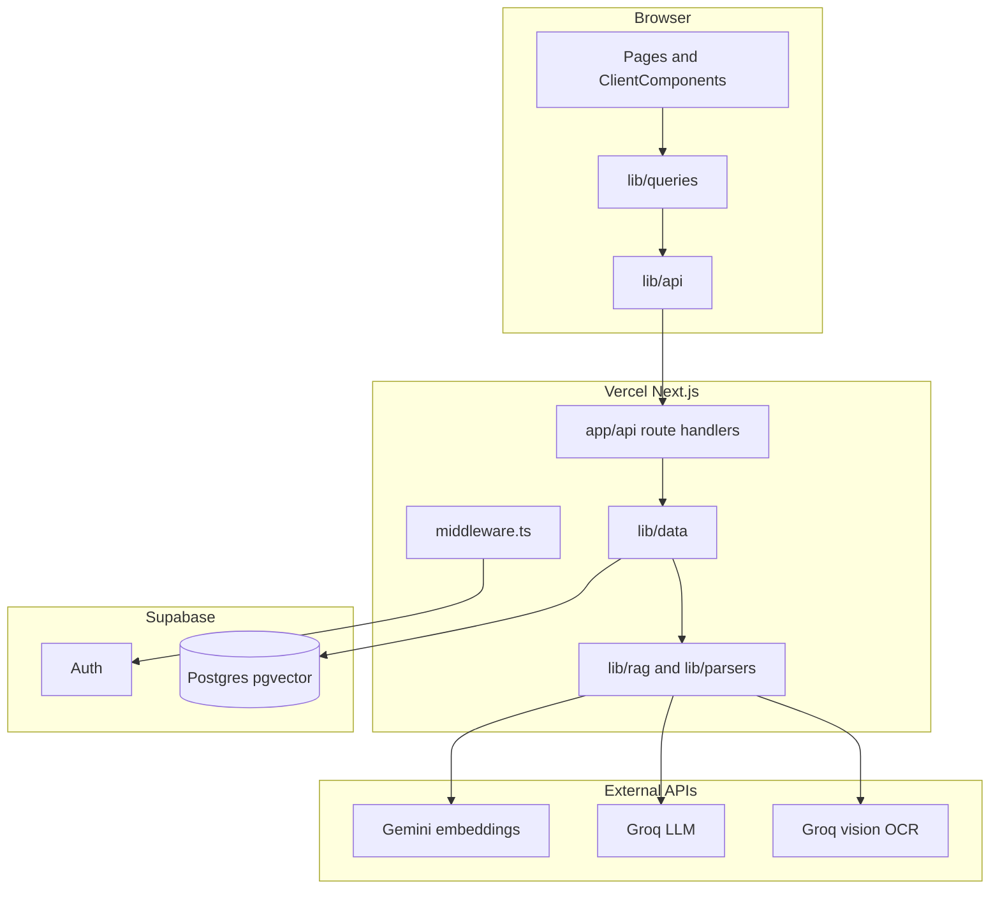
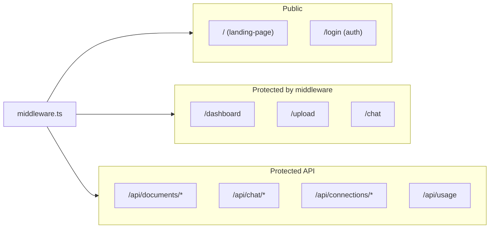
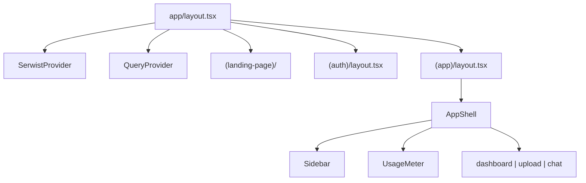
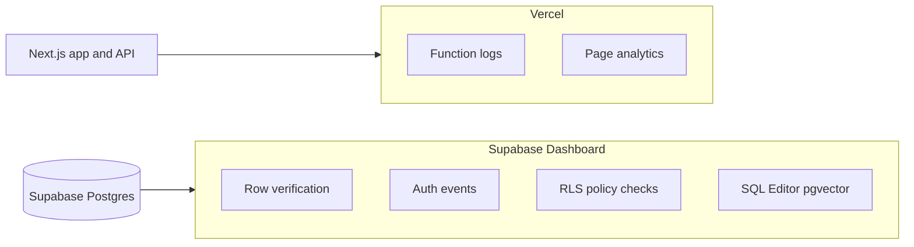

# Overall Architecture

Dosserai is a personal AI knowledge base: upload documents, extract and embed their contents in memory, discard the original file, and query across all documents with grounded answers and source citations.

## System context

| Layer | Technology | Role |
| --- | --- | --- |
| App | Next.js App Router | Pages, layouts, API route handlers |
| Client state | TanStack React Query | Cached server state, mutations, invalidation |
| Auth + DB | Supabase | Auth sessions, Postgres + pgvector, RLS |
| Embeddings | Gemini `gemini-embedding-001` | 1536-dimensional vectors (AI Studio free tier) |
| LLM | Groq `openai/gpt-oss-120b` | Document summaries and grounded answers |
| OCR | Groq Llama 4 Scout vision | Scanned images and image-based PDFs |
| Deploy | Vercel | Hosting, serverless functions, logs |

## Route groups

| Route group | Path prefix | Layout | Purpose |
| --- | --- | --- | --- |
| `(landing-page)` | `/` | Root layout | Public marketing |
| `(auth)` | `/login` | Auth layout | Sign-in |
| `(app)` | `/dashboard`, `/upload`, `/chat` | AppShell (sidebar, usage meter) | Authenticated product |

Protected paths are defined in `middleware.ts`. Unauthenticated users hitting protected pages are redirected to `/login?next=…`. Protected API routes return `401 JSON`.

## Layout hierarchy

## Product invariants

- **No file persistence** — uploads are processed in memory; only filename, upload date, summary, and vector chunks survive.
- **User isolation** — every owned table has `user_id`; RLS and RPC scoping enforce per-user access.
- **Grounded answers** — the LLM only sees retrieved chunks from the authenticated user's documents.
- **Cross-document connections** — computed at upload time from summary embeddings; surfaced at query time and on the dashboard.

## Observability

Two complementary layers — do not substitute one for the other.

| Symptom | Check first |
| --- | --- |
| HTTP error / timeout / crash in API | Vercel Logs |
| 200 response but empty UI | Supabase (rows + RLS) |
| Wrong or missing RAG answers | Supabase (chunks/embeddings), then Vercel (pipeline errors) |
| Login / session issues | Supabase Auth |
| Page traffic | Vercel Analytics |

Structured JSON logs from `lib/rag/` and `lib/data/` (embed ms, chunks retrieved, generate ms) are emitted from route handlers for Vercel function logs.

## Key files

- `app/layout.tsx` — root layout, QueryProvider, SerwistProvider
- `app/(app)/layout.tsx` — authenticated AppShell wrapper
- `middleware.ts` — session refresh and route protection
- `lib/data/` — server-only business logic and Supabase access
- `lib/rag/` — chunk, embed, search, generate
- `lib/parsers/` — PDF, DOCX, text, image OCR
- `lib/supabase/server.ts` — session and service-role clients
- `lib/config.ts` — chunk sizes, similarity thresholds, rate limits
