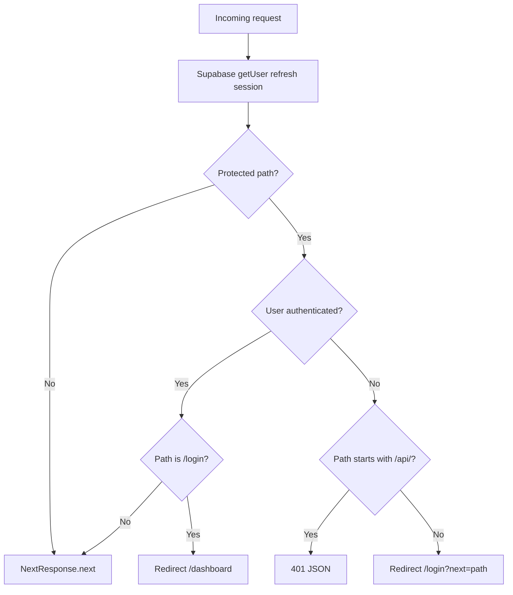
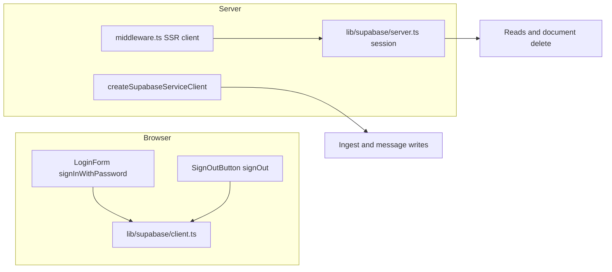
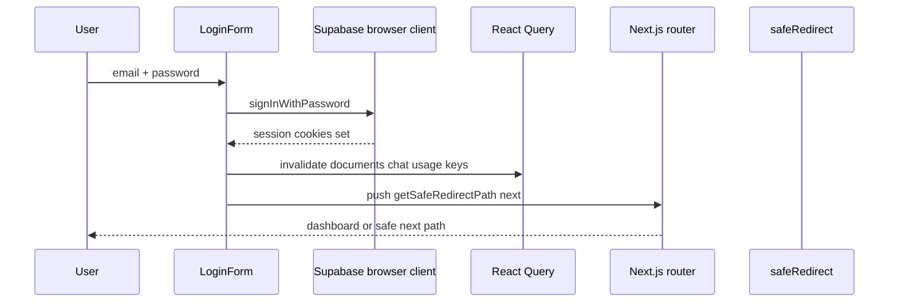
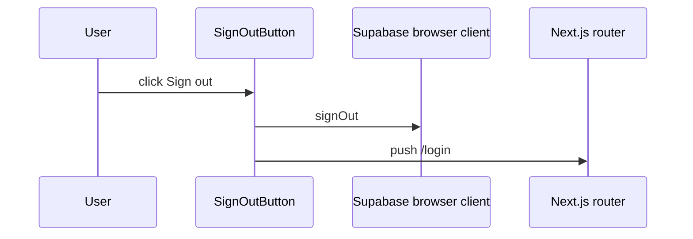
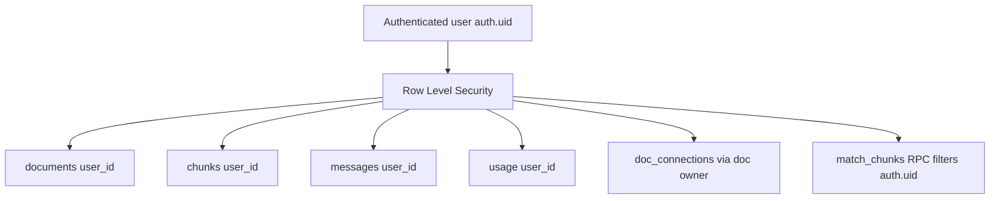

# Auth and Middleware

Authentication uses Supabase Auth with cookie-based sessions. Middleware refreshes the session on every matched request and gates protected routes.

## Middleware decision flow

### Protected paths

**Pages:** `/dashboard`, `/upload`, `/chat`

**APIs:** `/api/documents`, `/api/chat`, `/api/connections`, `/api/usage`

Matcher excludes static assets, Serwist routes, manifest, offline page, and favicon.

## Supabase clients

| Client | File | Use |
| --- | --- | --- |
| Browser | `lib/supabase/client.ts` | Login, sign-out |
| Server (session) | `lib/supabase/server.ts` | RLS-scoped reads, `getAuthenticatedUser`, `AuthError` |
| Service role | same file | Ingest and message writes only |

## Login sequence

Post-login redirect uses `getSafeRedirectPath` from `lib/auth/safeRedirect.ts` to block open redirects. Default destination is `/dashboard`.

If an authenticated user visits `/login`, middleware redirects them to `/dashboard` immediately.

## Sign-out sequence

## Data isolation

Defense in depth:

- Every user-owned table has `user_id`.
- RLS policies restrict SELECT (and DELETE on documents) to `auth.uid()`.
- Vector search RPC `match_chunks` filters `c.user_id = auth.uid()`.
- `doc_connections` trigger ensures both linked documents belong to the same user.
- Service-role writes always set `user_id` from the authenticated session, never from client input.

## Key files

- `middleware.ts`
- `lib/supabase/client.ts`
- `lib/supabase/server.ts`
- `lib/auth/safeRedirect.ts`
- `app/(auth)/login/LoginForm.tsx`
- `components/layout/SignOutButton.tsx`
- `supabase/migrations/003_security_hardening.sql`
