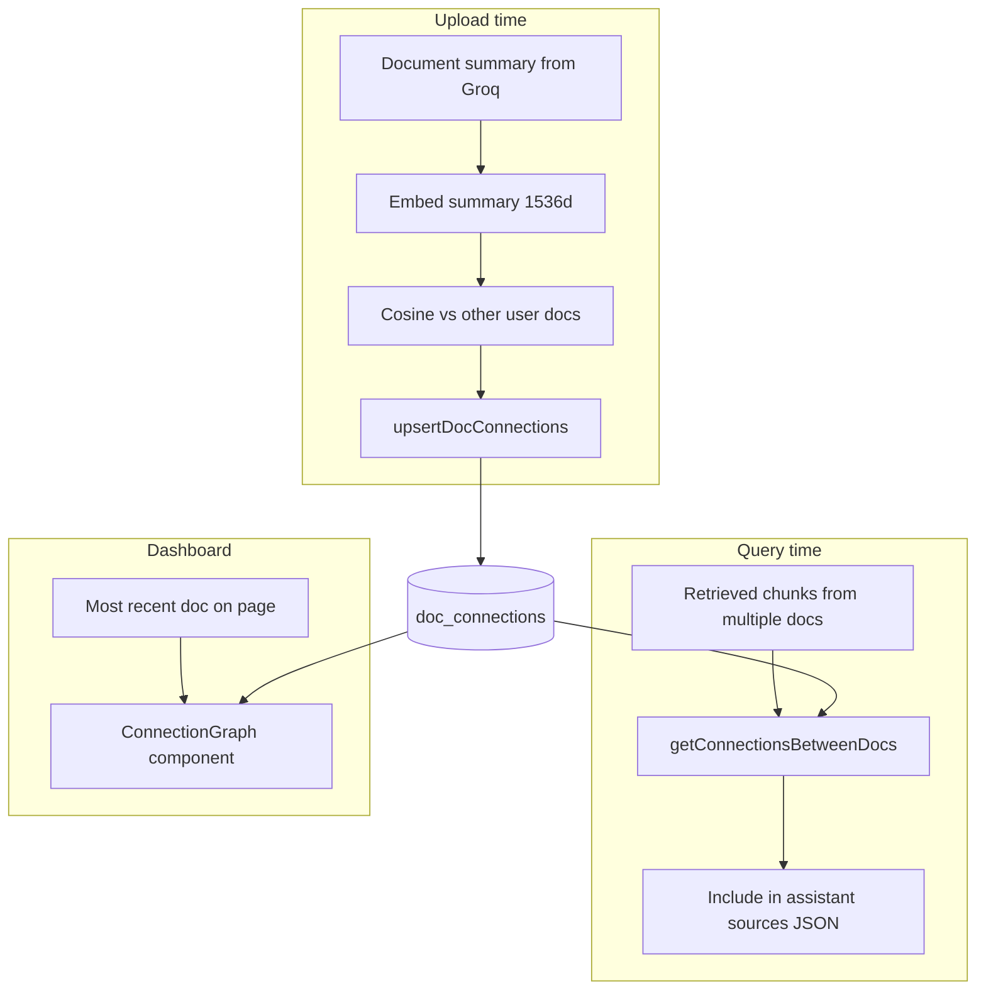
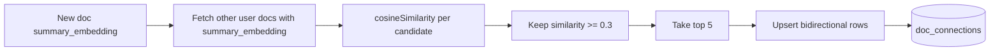
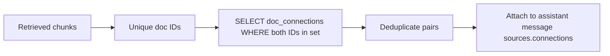
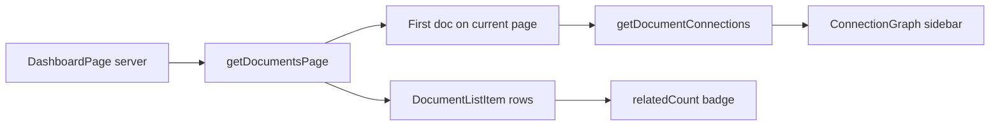

# Cross-Document Connections

Cross-document connections are a core product feature. Related documents are discovered automatically at upload time and surfaced at query time and on the dashboard.

## Overview

## Upload-time connection logic

When a document is ingested, after the summary is generated and embedded:

Configuration from `lib/config.ts`:

| Constant | Value |
| --- | --- |
| `DOC_CONNECTION_SIMILARITY_THRESHOLD` | 0.3 |
| `TOP_DOC_CONNECTIONS` | 5 |

Each match creates **two rows** (A→B and B→A) with the same similarity score. Upsert uses `onConflict: doc_id,related_doc_id`.

Writes use the service role client. A database trigger (`doc_connections_same_user`) ensures both documents belong to the same user.

## Query-time connection logic

During `submitChatQuery`, after vector search and reranking:

Connections are only returned when chunks from **two or more documents** appear in the retrieval set. Stored in `messages.sources` JSONB alongside citations.

## Dashboard display

- **Connection graph** — shown for the most recent document on the current page (featured doc).
- **Badge** — each list row shows `relatedCount` from a Supabase aggregate on `doc_connections`.

## API

| Method | Path | Function |
| --- | --- | --- |
| GET | `/api/connections/[docId]` | `getDocumentConnections` |

## Key files

- `lib/data/connections.ts` — `upsertDocConnections`, `getDocumentConnections`
- `lib/data/chat.ts` — `getConnectionsBetweenDocs`
- `lib/data/documents.ts` — calls `upsertDocConnections` after ingest
- `lib/rag/search.ts` — `cosineSimilarity`
- `components/dashboard/ConnectionGraph.tsx`
- `components/dashboard/DocumentListItem.tsx`
- `app/api/connections/[docId]/route.ts`
- `supabase/migrations/003_security_hardening.sql` — same-user trigger
