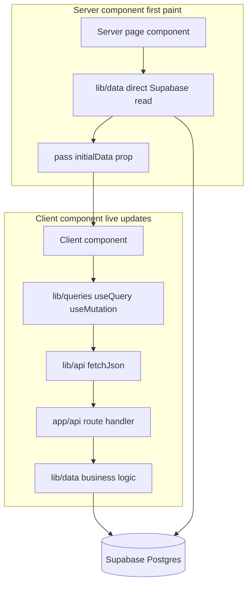
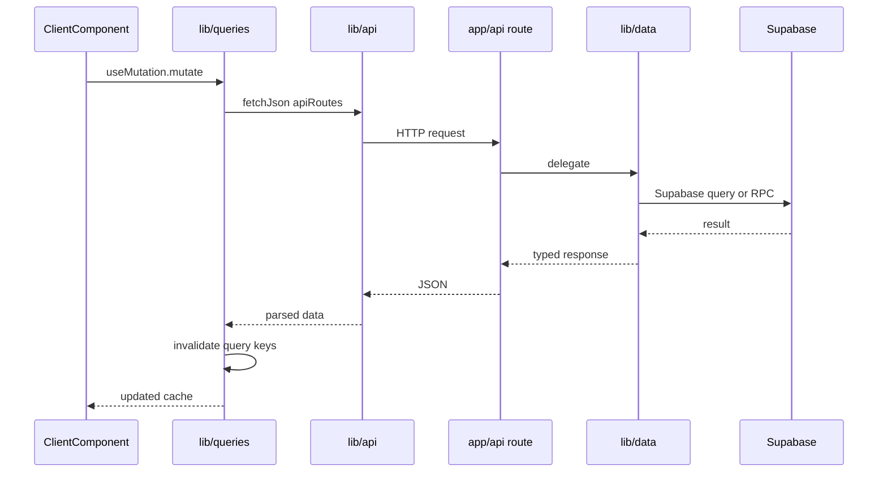
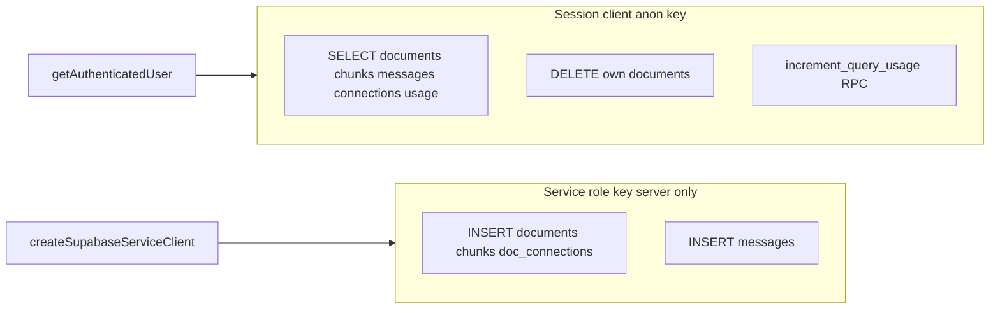
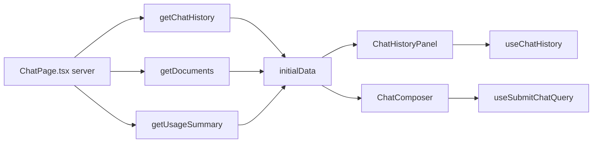

# Data Flow

Dosserai uses a **hybrid SSR + React Query** model: fast first paint from the server, live updates from the client cache after mutations.

## Three-layer pattern

| Layer | Location | Role |
| --- | --- | --- |
| Data access | `lib/data/` | Supabase reads/writes with RLS. Server-only — never imported from client components. |
| HTTP client | `lib/api/` | Typed browser fetch helpers. Paths in `routes.ts`, shared JSON handling in `client.ts`. |
| Server state | `lib/queries/` | React Query hooks, query keys, cache invalidation after mutations. |
| Provider | `components/layout/QueryProvider.tsx` | `QueryClientProvider` in root layout. |

## Request sequence (client mutation)

## Supabase client split

| Operation | Client | Notes |
| --- | --- | --- |
| List/read documents, chunks, messages | Session | RLS-scoped to `auth.uid()` |
| Delete document | Session | RLS allows DELETE on own rows; cascades chunks and connections |
| Upload ingest writes | Service role | `user_id` always from authenticated session, never from request body |
| Chat message writes | Service role | Same — session provides `user_id` |
| Query usage increment | Service role RPC | Atomic daily cap in `increment_query_usage` (`p_user_id` from session) |

The service role key is never exposed to the browser. RLS policies in `001_initial_schema.sql` block client INSERT/UPDATE on ingest-related tables.

## Conventions

- Server components load real data via `lib/data/` and pass it as `initialData` to client query components.
- Client components never call `fetch("/api/...")` directly — use hooks from `lib/queries/`.
- After mutations (upload, delete, chat query), invalidate related query keys instead of `router.refresh()`.
- All API paths are defined once in `lib/api/routes.ts` (`apiRoutes`).

## Example: chat page wiring

## Adding a new client-facing endpoint

1. Implement `lib/data/foo.ts`
2. Add `app/api/foo/route.ts` delegating to `lib/data/`
3. Add path to `lib/api/routes.ts`
4. Add `fetchFoo` in `lib/api/foo.ts`
5. Add `useFoo` / `useUpdateFoo` in `lib/queries/foo.ts` with keys in `lib/queries/keys.ts`

## Key files

- `lib/data/documents.ts`, `lib/data/chat.ts`, `lib/data/usage.ts`, `lib/data/connections.ts`
- `lib/api/routes.ts`, `lib/api/client.ts`, `lib/api/handleRouteError.ts`
- `lib/queries/keys.ts`, `lib/queries/documents.ts`, `lib/queries/chat.ts`, `lib/queries/usage.ts`
- `lib/supabase/server.ts`
- `supabase/migrations/001_initial_schema.sql`
