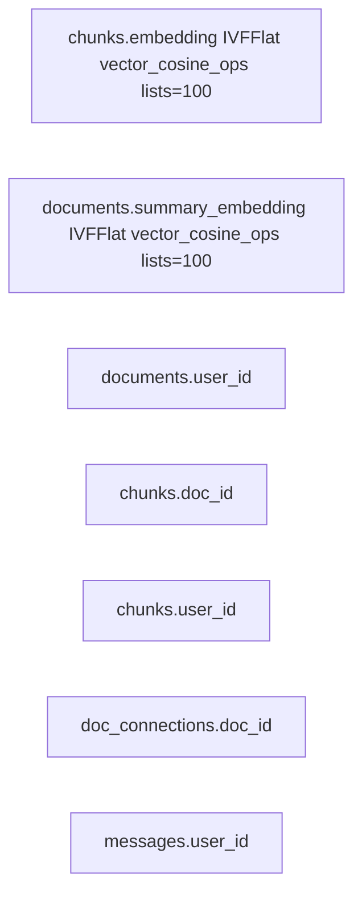
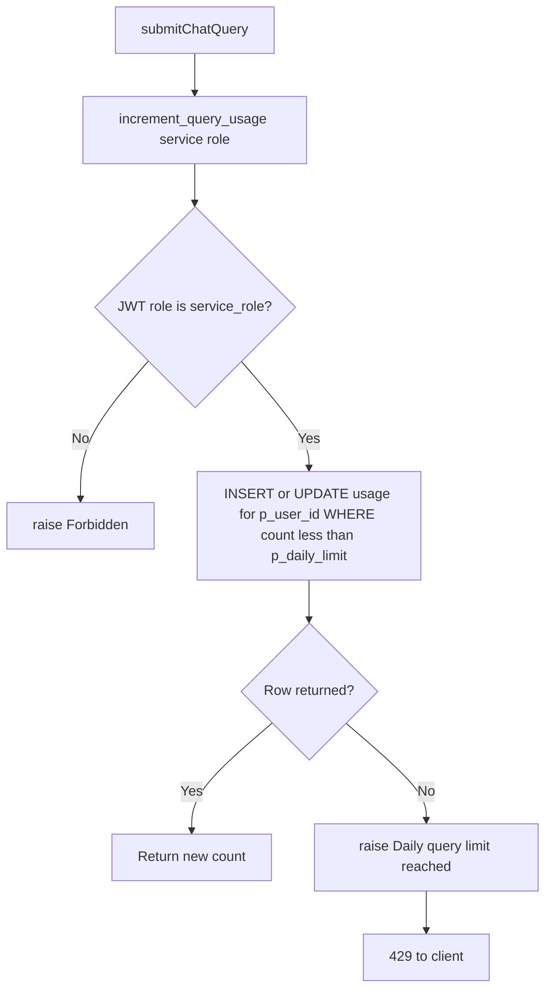

# Database Schema

PostgreSQL on Supabase with the `pgvector` extension. Schema lives in `supabase/migrations/`.

## Entity-relationship diagram

```mermaid
erDiagram
  auth_users ||--o{ documents : owns
  auth_users ||--o{ chunks : owns
  auth_users ||--o{ messages : owns
  auth_users ||--o{ usage : tracks

  documents ||--o{ chunks : contains
  documents ||--o{ doc_connections : "doc_id"
  documents ||--o{ doc_connections : "related_doc_id"

  documents {
    uuid id PK
    uuid user_id FK
    text filename
    text summary
    vector summary_embedding "1536d"
    timestamptz uploaded_at
  }

  chunks {
    uuid id PK
    uuid user_id FK
    uuid doc_id FK
    text content
    vector embedding "1536d"
    int chunk_index
    jsonb metadata
  }

  doc_connections {
    uuid doc_id PK_FK
    uuid related_doc_id PK_FK
    float similarity
  }

  messages {
    uuid id PK
    uuid user_id FK
    text role
    text content
    jsonb sources
    timestamptz created_at
  }

  usage {
    uuid user_id PK_FK
    date date PK
    int queries_count
  }
```

## Indexes



Vector indexes use IVFFlat with cosine distance (`vector_cosine_ops`). Used by `match_chunks` RPC for query-time retrieval and by upload-time summary similarity for connections.

## RLS policy matrix

After `003_security_hardening.sql`:

| Table | Session client SELECT | Session client DELETE | Service role INSERT/UPDATE |
| --- | --- | --- | --- |
| `documents` | Own rows (`auth.uid() = user_id`) | Own rows | Ingest pipeline |
| `chunks` | Own rows | — | Ingest pipeline |
| `doc_connections` | Via owning `doc_id` | — | Upload connections |
| `messages` | Own rows | — | Chat pipeline |
| `usage` | Own rows | — | Via `increment_query_usage` RPC only |

Client components and the anon/session key cannot INSERT or UPDATE on ingest-related tables. Deletes on documents cascade to chunks and connections via foreign keys.

## increment_query_usage RPC



- `SECURITY DEFINER` — only `service_role` may execute; limit and user id come from the server.
- Atomic — prevents race conditions on concurrent queries.
- Default limit: 50/day (`DAILY_QUERY_LIMIT` env, fallback in `lib/config.ts`).

## Cascade behavior

Deleting a document:

```
DELETE documents WHERE id = ?
  → CASCADE chunks (all embeddings removed)
  → CASCADE doc_connections (both doc_id and related_doc_id FKs)
```

No object storage cleanup — original files are never persisted.

## Key files

- `supabase/migrations/001_initial_schema.sql`
- `supabase/migrations/002_match_chunks_rpc.sql`
- `supabase/migrations/003_security_hardening.sql`
- `supabase/migrations/004_increment_usage_service_only.sql`
- `lib/config.ts` — `getDailyQueryLimit()`
- `lib/data/usage.ts` — `incrementUsage()`
