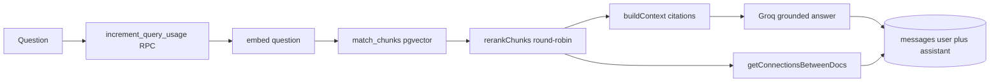
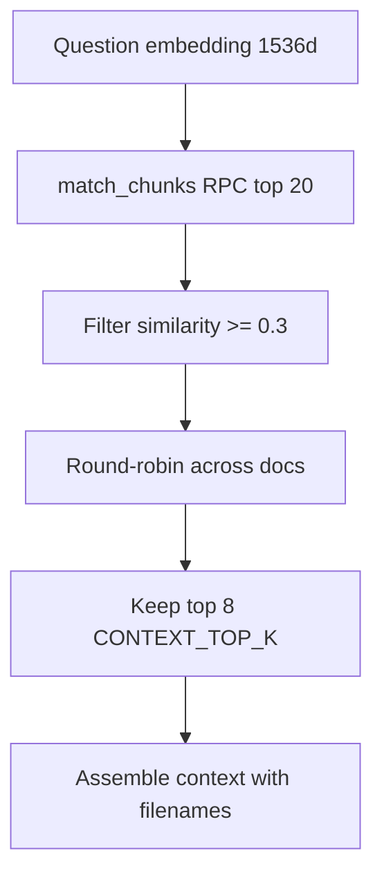
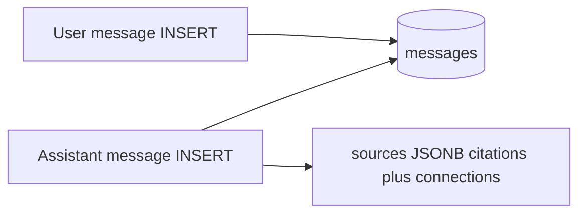
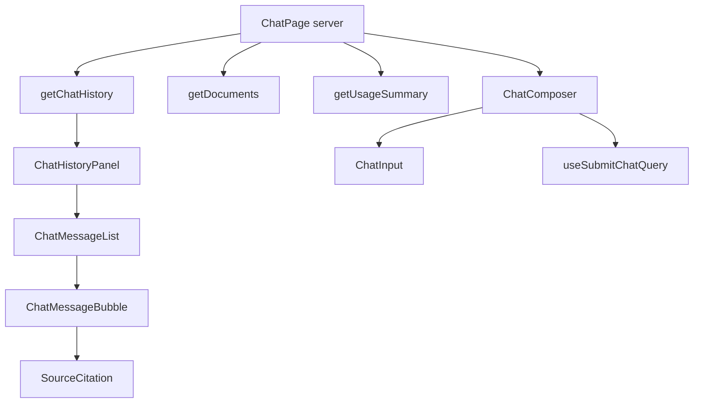

# Chat

Natural-language RAG queries across all uploaded documents. Answers are grounded in retrieved chunks with source citations and cross-document connections.

## User flow

1. User opens `/chat`.
2. Server loads chat history, document list, and usage summary.
3. History renders in scrollable panel; empty state if no messages.
4. User types a question → `POST /api/chat/query`.
5. Server runs RAG pipeline; assistant message returned with citations and connections.
6. Input disabled if no documents exist or daily query limit reached.
7. Usage meter updates after each query.

## RAG query pipeline

## Vector search and reranking

- **Search:** `match_chunks` RPC scoped to `auth.uid()` (see `002_match_chunks_rpc.sql`).
- **Reranking:** Ensures diversity — one chunk per document per round until 8 chunks selected.
- **No-context fallback:** Fixed message when no chunks pass the similarity threshold.

Configuration from `lib/config.ts`:

| Constant | Value |
| --- | --- |
| `SEARCH_TOP_K` | 20 |
| `CONTEXT_TOP_K` | 8 |
| `MIN_CHUNK_SIMILARITY` | 0.3 |

## Message persistence

Assistant `sources` stores `{ citations, connections }`. Rehydrated on history load via `parseMessageSources`.

## UI component flow

## Usage limits

- Default: 50 queries/day (`DAILY_QUERY_LIMIT` env).
- Enforced atomically via `increment_query_usage` RPC before search (429 on exceed).
- Client pre-disables input at limit; server enforces regardless.

## API endpoints

| Method | Path | Body | Response |
| --- | --- | --- | --- |
| GET | `/api/chat/history` | — | `{ messages }` |
| POST | `/api/chat/query` | `{ question }` | `{ message }` (assistant) |

## Key files

- `app/(app)/chat/page.tsx`
- `app/(app)/chat/ChatPage.tsx`
- `components/chat/ChatHistoryPanel.tsx`
- `components/chat/ChatMessageList.tsx`
- `components/chat/ChatMessageBubble.tsx`
- `components/chat/SourceCitation.tsx`
- `components/chat/ChatComposer.tsx`
- `components/chat/ChatInput.tsx`
- `app/api/chat/query/route.ts`
- `app/api/chat/history/route.ts`
- `lib/data/chat.ts` — `submitChatQuery`, `getChatHistory`
- `lib/rag/search.ts` — `searchChunks`, `rerankChunks`
- `lib/rag/generate.ts` — `generateGroundedAnswer`
- `lib/rag/embed.ts`
- `lib/data/usage.ts` — `incrementUsage`
- `lib/queries/chat.ts`
- `lib/api/chat.ts`
- `supabase/migrations/002_match_chunks_rpc.sql`
