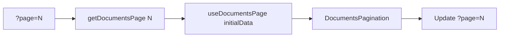
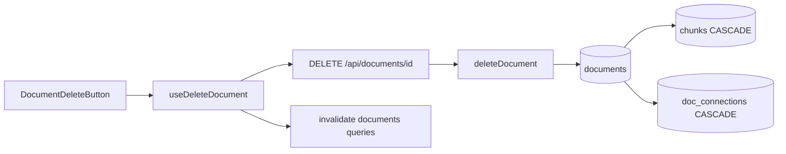

# Dashboard

Document list with pagination, delete, and a cross-document connection graph for the featured document.

## User flow

1. Authenticated user opens `/dashboard` (optional `?page=N`).
2. Server loads paginated documents and connections for the **most recent** document on the page.
3. Client hydrates via React Query; pagination updates URL.
4. Each row shows filename, upload date, linked-doc count badge, and delete button.
5. Sidebar shows `ConnectionGraph` for the featured document's related documents.
6. Empty state prompts upload when no documents exist.

## Component flow

```mermaid
flowchart TB
  Page[DashboardPage server] --> getDocumentsPage
  Page --> getDocumentConnections featured doc
  getDocumentsPage --> initialData
  getDocumentConnections --> initialData
  initialData --> DashboardDocuments client
  DashboardDocuments --> useDocumentsPage
  DashboardDocuments --> DocumentListItem
  DashboardDocuments --> DocumentsPagination
  DashboardDocuments --> ConnectionGraph
  DocumentListItem --> DocumentDeleteButton
  DocumentDeleteButton --> useDeleteDocument
```

## Pagination



- Page size: 20 documents (`DOCUMENTS_PAGE_SIZE` in `lib/config.ts`).
- Documents ordered by `uploaded_at` descending.

## Delete cascade



Returns `204 No Content`. No file storage to clean up — only metadata and vectors are removed.

## Connection graph

The sidebar graph shows connections for the **first document** on the current page (most recently uploaded on that page). Each list row displays a `relatedCount` badge from a Supabase aggregate.

See [cross-document-connections.md](../cross-document-connections.md) for connection logic details.

## API endpoints

| Method | Path | Data function |
| --- | --- | --- |
| GET | `/api/documents/list` | `getDocuments` or `getDocumentsPage` |
| GET | `/api/connections/[docId]` | `getDocumentConnections` |
| DELETE | `/api/documents/[id]` | `deleteDocument` |

## Display constraints

Only **filename** and **upload date** are shown — no file download, preview, or re-fetch of originals (they are never stored).

## Key files

- `app/(app)/dashboard/page.tsx`
- `app/(app)/dashboard/DashboardPage.tsx`
- `components/dashboard/DashboardDocuments.tsx`
- `components/dashboard/DocumentListItem.tsx`
- `components/dashboard/DocumentDeleteButton.tsx`
- `components/dashboard/DocumentsPagination.tsx`
- `components/dashboard/ConnectionGraph.tsx`
- `lib/data/documents.ts`
- `lib/data/connections.ts`
- `lib/queries/documents.ts`
- `lib/api/documents.ts`
- `app/api/documents/list/route.ts`
- `app/api/documents/[id]/route.ts`
- `app/api/connections/[docId]/route.ts`
