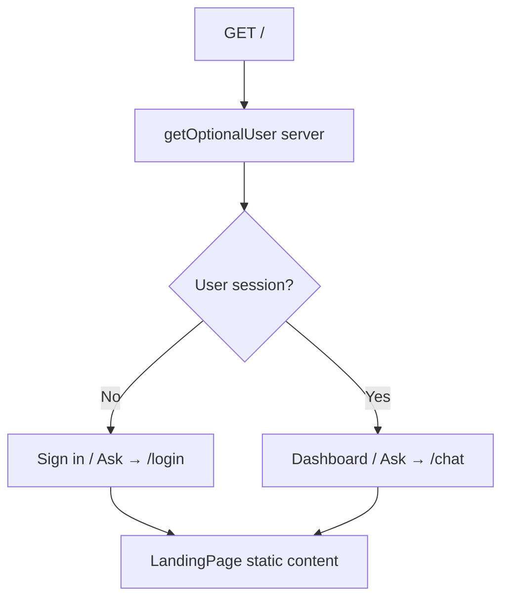
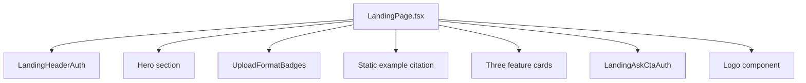

# Landing Page

Public marketing page at `/`. No API calls — static content with auth-aware CTAs.

## User flow

1. Visitor lands on `/`.
2. Sees hero, format badges, static example answer/citation, and three feature cards.
3. Header CTA: **Sign in** (guest) or **Dashboard** (authenticated).
4. Hero "Ask" bar: links to `/login` (guest) or `/chat` (authenticated).

## Auth-aware branching

`LandingHeaderAuth` and `LandingAskCtaAuth` are small server components that read session state and render the appropriate links.

## Page structure

The example citation and feature copy are intentional static marketing content — not live user data.

## API endpoints

None.

## Data layer

None. Auth state only via `getOptionalUser()` from `lib/supabase/server.ts`.

## Key files

- `app/(landing-page)/page.tsx`
- `app/(landing-page)/LandingPage.tsx`
- `app/(landing-page)/LandingHeaderAuth.tsx`
- `app/(landing-page)/LandingAskCtaAuth.tsx`
- `components/shared/Logo.tsx`
- `components/upload/UploadFormatBadges.tsx`
