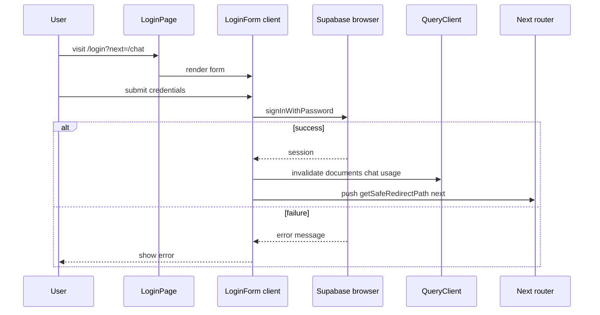
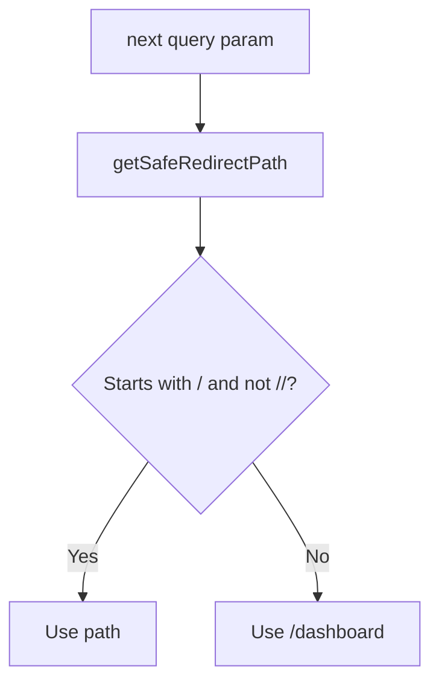
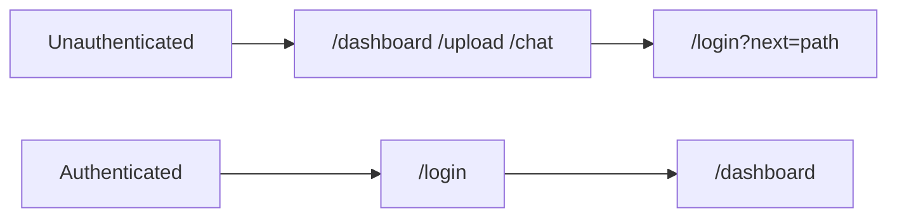

# Login

Email/password sign-in at `/login`. Uses Supabase Auth directly from the browser — no app API route.

## User flow

1. User visits `/login` (optionally `?next=/chat`).
2. Enters email and password.
3. `signInWithPassword` via Supabase browser client.
4. On success: React Query caches invalidated (documents, chat, usage).
5. Redirect to safe `next` path (default `/dashboard`).
6. Middleware blocks already-authenticated users from staying on `/login` (redirects to `/dashboard`).

There is no `/register` route in the app — user accounts are created via Supabase Auth (dashboard or external sign-up).

## Login sequence

## Redirect sanitization

Prevents open redirect attacks (e.g. `?next=https://evil.com`).

## Middleware interaction

## Sign-out (related)

Sign-out is handled by `SignOutButton` in the app shell, not on the login page:

- `supabase.auth.signOut()` → navigate to `/login`

See [auth-and-middleware.md](../auth-and-middleware.md) for full auth diagrams.

## API endpoints

None — direct Supabase Auth from browser.

## Key files

- `app/(auth)/login/page.tsx`
- `app/(auth)/login/LoginPage.tsx`
- `app/(auth)/login/LoginForm.tsx`
- `app/(auth)/layout.tsx`
- `lib/supabase/client.ts`
- `lib/auth/safeRedirect.ts`
- `middleware.ts`
