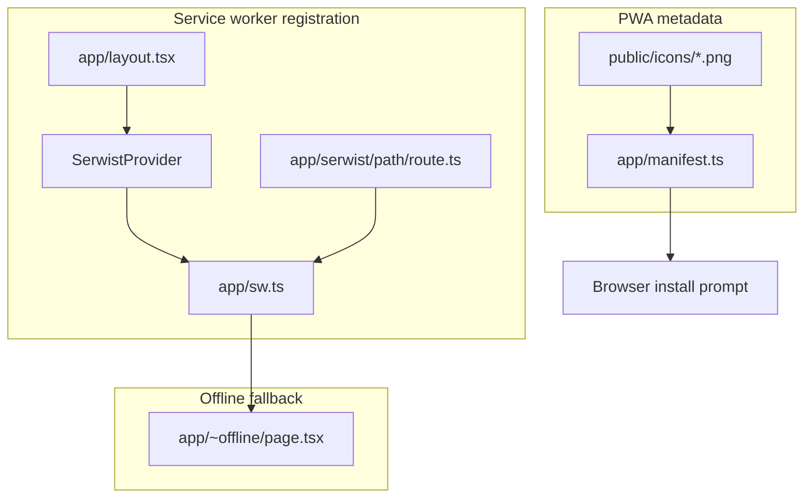
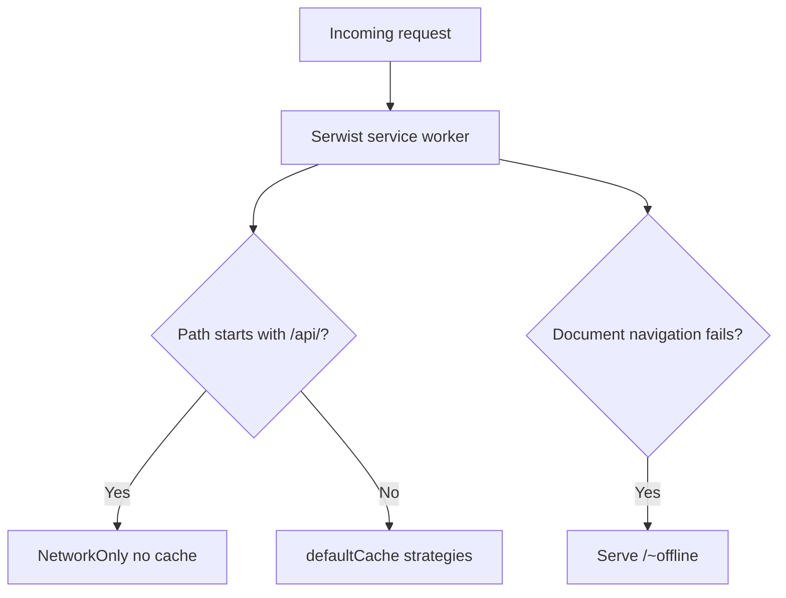

# PWA and Offline

Progressive Web App support via Serwist. Provides installability, asset caching, and an offline fallback page.

## Overview

## Service worker behavior

Key design choices in `app/sw.ts`:

- **API routes** — `NetworkOnly` handler; RAG and document data are never cached by the SW.
- **Static assets** — Serwist `defaultCache` precaching and runtime caching.
- **Navigation fallback** — document requests that fail offline serve `/~offline`.
- **`skipWaiting` + `clientsClaim`** — new SW activates immediately.

## Manifest

Generated by `app/manifest.ts`:

| Field | Value |
| --- | --- |
| `name` | Dosserai |
| `start_url` | `/dashboard` |
| `display` | `standalone` |
| Icons | 192, 512, maskable 512 |

Icons live in `public/icons/`.

## Middleware exclusion

The middleware matcher excludes Serwist and PWA paths so they are not subject to auth redirects:

- `serwist/`
- `manifest.webmanifest`
- `~offline`

See `middleware.ts` `config.matcher`.

## Offline page

`app/~offline/page.tsx` — static page shown when a document navigation fails and the user has no network. Does not attempt to load user data.

## What is NOT cached offline

- Chat history and RAG queries (`/api/*` → NetworkOnly)
- Document list and upload
- Any authenticated API responses

The PWA improves shell load and installability; core product features require network access.

## Key files

- `app/sw.ts`
- `app/serwist/[path]/route.ts`
- `app/manifest.ts`
- `app/~offline/page.tsx`
- `app/layout.tsx` — SerwistProvider
- `middleware.ts` — matcher exclusions
- `public/icons/icon-192.png`
- `public/icons/icon-512.png`
- `public/icons/icon-maskable-512.png`
- `scripts/generate-pwa-icons.mjs`
