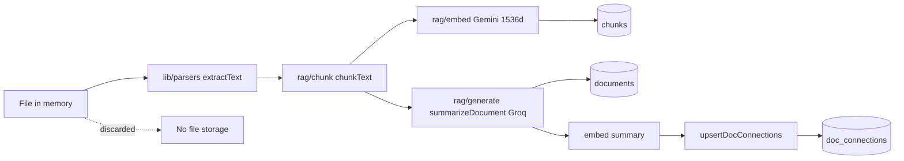
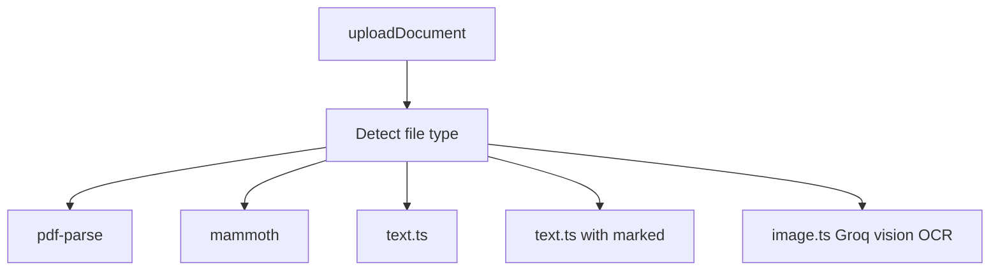
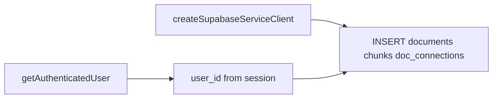

# Upload

Drag-and-drop document ingest. Files are processed **in memory only** — original bytes are never persisted.

## User flow

1. User opens `/upload`.
2. Drags or selects files (PDF, DOCX, TXT, MD, PNG/JPG/WEBP).
3. Client validates extension and 10 MB size limit.
4. Files uploaded sequentially via `POST /api/documents/upload`.
5. Server runs the full ingest pipeline; original file discarded.
6. Success invalidates document queries; per-file errors shown in UI.

## Ingest pipeline

## Parser routing

| Type | Parser | External API |
| --- | --- | --- |
| PDF | `lib/parsers/pdf.ts` | — |
| DOCX | `lib/parsers/docx.ts` | — |
| TXT | `lib/parsers/text.ts` | — |
| Markdown | `lib/parsers/text.ts` | — |
| Images | `lib/parsers/image.ts` | Groq Llama 4 Scout vision |

## Processing details

| Step | Module | Config |
| --- | --- | --- |
| Chunking | `lib/rag/chunk.ts` | ~500 tokens, 100 overlap, max 200 chunks/doc |
| Embeddings | `lib/rag/embed.ts` | `gemini-embedding-001`, 1536d, batches of 32 |
| Summary | `lib/rag/generate.ts` | Groq LLaMA 3.3 70B, 2–3 sentences |
| Connections | `lib/data/connections.ts` | Top 5, similarity ≥ 0.3 |

## Rate and size limits

| Limit | Default | Env var |
| --- | --- | --- |
| File size | 10 MB | — |
| Chunks per document | 200 | — |
| Daily uploads | 20 | `DAILY_UPLOAD_LIMIT` |
| Hourly uploads | 5 | `HOURLY_UPLOAD_LIMIT` |

Rate limits are enforced in `assertUploadRateLimits()` by counting recent `documents` rows.

## Write model

Service role client performs inserts; `user_id` always comes from the authenticated session.

Route handler sets `maxDuration = 60` seconds for long-running ingest.

## API endpoints

| Method | Path | Body | Response |
| --- | --- | --- | --- |
| POST | `/api/documents/upload` | `multipart/form-data` (`file`) | `{ id }` (201) |

## Key files

- `app/(app)/upload/page.tsx`
- `app/(app)/upload/UploadPage.tsx`
- `components/upload/UploadDropzone.tsx`
- `components/upload/UploadFormatBadges.tsx`
- `app/api/documents/upload/route.ts`
- `lib/data/documents.ts` — `uploadDocument`, `assertUploadRateLimits`
- `lib/parsers/index.ts`
- `lib/rag/chunk.ts`
- `lib/rag/embed.ts`
- `lib/rag/generate.ts`
- `lib/data/connections.ts`
- `lib/config.ts`
- `lib/queries/documents.ts` — `useUploadDocument`
