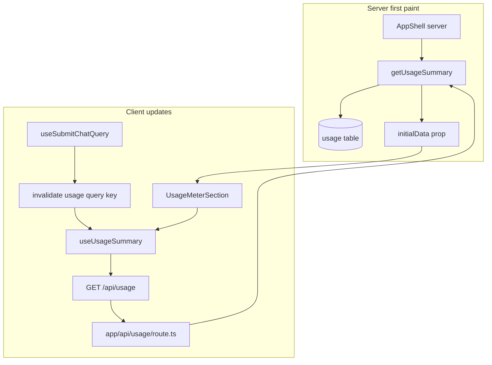
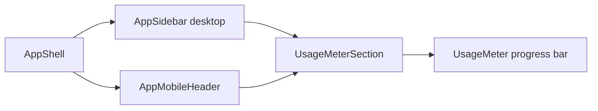
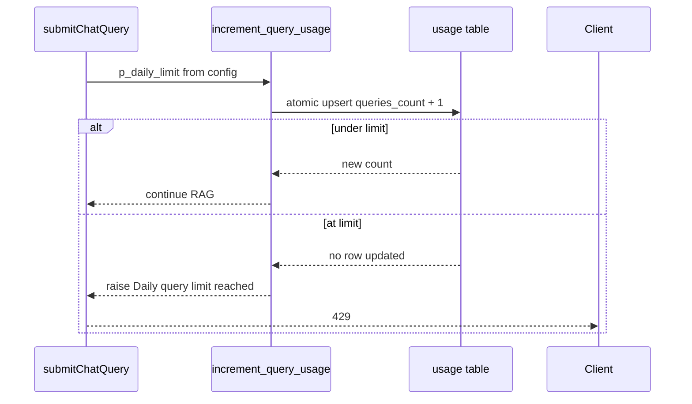

# Usage Meter

Cross-feature UI showing daily query usage (`queriesToday / dailyLimit`) in the authenticated app shell.

## User flow

1. User opens any authenticated page (`/dashboard`, `/upload`, `/chat`).
2. `AppShell` server component fetches usage summary on first paint.
3. `UsageMeterSection` displays progress bar in desktop sidebar and mobile header.
4. After a chat query, React Query invalidates the usage key and the meter updates.

## Data flow

## Display locations

## Usage increment (chat only)

Query count increments in `submitChatQuery` **before** RAG search via the `increment_query_usage` RPC:

Uploads do not increment the usage meter — upload limits are tracked separately via document counts.

## Configuration

| Setting | Default | Env var |
| --- | --- | --- |
| Daily query limit | 50 | `DAILY_QUERY_LIMIT` |

Read via `getDailyQueryLimit()` in `lib/config.ts`.

## API endpoints

| Method | Path | Response |
| --- | --- | --- |
| GET | `/api/usage` | `{ queriesToday, dailyLimit }` |

## Key files

- `components/layout/AppShell.tsx`
- `components/shared/UsageMeterSection.tsx`
- `components/shared/UsageMeter.tsx`
- `lib/data/usage.ts` — `getUsageSummary`, `incrementUsage`
- `lib/queries/usage.ts` — `useUsageSummary`
- `lib/api/usage.ts`
- `app/api/usage/route.ts`
- `lib/queries/chat.ts` — invalidates usage after query
- `lib/config.ts`
